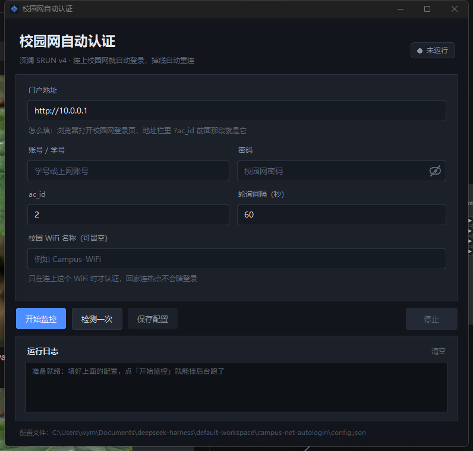

# 校园网自动认证（深澜 SRUN）

一个开箱即用的校园网自动登录小工具，带图形界面。连着校园 WiFi 就能自动认证，掉线了自动重连，专治「一觉醒来网没了」。

> 协议实现针对**深澜 SRUN v4**门户（`/cgi-bin/get_challenge`、`/cgi-bin/srun_portal`、`/cgi-bin/rad_user_info`），国内多数高校的校园网都是这套。不是深澜门户的话用不了。



## 直接下载就能用（不用装 Python）

去 [Releases](https://github.com/WYMLY/campus-net-autologin/releases/latest) 下载 `CampusNetAutoLogin-v1.0.1.exe`（就是主程序），双击打开，填好门户地址、学号、密码，点「开始监控」即可。

- Windows 10 / 11 64 位，单文件，不依赖 Python 环境
- 第一次运行如果被 SmartScreen 拦一下，点「更多信息 → 仍要运行」
- 程序会在 **exe 同目录**生成 `config.json` 存账号密码，只留在你本机，不会上传

想从源码跑、或者做成开机自启，看下面。

## 特性

- **纯 Python 标准库**，零第三方依赖，不用 pip 装任何东西
- **图形界面**：双击就能跑，不碰命令行
- **命令行版**同样可用，适合开机自启、无窗口后台常驻
- **掉线自动重连**：每 N 秒检测一次，断了就重新认证
- **只认权威状态**：不看门户是不是返回 200（认证页劫持会骗人），只认 `rad_user_info` 里的 `user_name` + `online_ip` 与本机 IP 是否对得上
- **WiFi 白名单**：只有连上你指定的校园 WiFi 才会动作，回家/连热点时不会瞎登录
- **账号密码不进代码**：全部从 `config.json` 或环境变量读，`config.json` 已在 `.gitignore` 里

## 快速开始

### 方式一：图形界面（推荐）

1. 装好 Python 3.8+（安装时勾上 `Add Python to PATH`）
2. 把 `config.example.json` 复制一份，改名为 `config.json`
3. 双击 `campus_net_autologin_gui.py`（或者 `python campus_net_autologin_gui.py`）
4. 填门户地址、`ac_id`、学号、密码、校园 WiFi 名，点「保存配置」
5. 点「开始监控」，之后就不用管了

### 方式二：命令行

```bash
# 复制配置模板
copy config.example.json config.json     # Windows
cp config.example.json config.json       # Linux / macOS

# 常驻监控
python campus_net_autologin.py

# 无窗口后台（Windows，配合开机自启）
pythonw campus_net_autologin.py

# 只检测一次就退出
python campus_net_autologin.py --once

# 手动登出（慎用，一般用不到）
python campus_net_autologin.py --logout

# 指定别的配置文件
python campus_net_autologin.py --config D:\somewhere\my.json
```

## 配置说明

门户地址和 `ac_id` 怎么找：连上校园网但还没认证时，会自动弹一个认证页，看一眼地址栏：

```
http://10.100.0.1/srun_portal_pc?ac_id=2&theme=basic
      └─ 门户地址 ─┘            └ ac_id ┘
```

### `ac_id` 到底是什么

认证服务器内部给「上网区域 / 设备组」编的号。学校把不同楼、不同网段、有线跟无线分开统计时，就会给不同的 `ac_id`。它不影响账号密码，填错的后果是认证被拒或者一直被踢下线。

**不知道填几就填 `2`**，绝大多数学校是 2；如果不行，照浏览器地址栏 `?ac_id=` 后面那个数字抄。

| 字段 | 说明 |
| --- | --- |
| `portal_host` | 门户地址，形如 `http://10.x.x.x`，**不带**结尾斜杠和路径 |
| `ac_id` | 认证区域编号，多数学校填 `2`，以认证页 URL 里的 `ac_id=` 为准 |
| `username` | 学号 / 上网账号 |
| `password` | 校园网认证密码 |
| `target_wifi_ssid` | 只在连接这个 WiFi 时才认证；留空表示不限制 |
| `check_interval` | 轮询间隔（秒），最小 10，默认 60 |
| `timeout` | 单次 HTTP 超时（秒），默认 8 |

优先级：**环境变量 > config.json > 代码里的默认值**。可用环境变量：

```
CAMPUS_PORTAL_HOST  CAMPUS_AC_ID  CAMPUS_USERNAME
CAMPUS_PASSWORD     CAMPUS_WIFI_SSID  CAMPUS_INTERVAL
```

> 用环境变量可以做到「配置文件里没有密码」，比如放在只自己可读的脚本里 set 一下再启动。

## 开机自启

最简单：`Win + R` 输入 `shell:startup`，把下面这个快捷方式丢进去。

```bat
pythonw "C:\你的路径\campus_net_autologin.py"
```

先建一个 `.bat` 写上这一行，再把 `.bat` 放启动目录，就不会有黑窗口。

要更稳一点（比如断网后重试更勤），用「任务计划程序」：触发器选「登录时」，操作填 `pythonw.exe`，参数填脚本完整路径，勾上「不管用户是否登录都运行」更保险。

## 打包成单个 exe（可选）

不想让同学装 Python，就打个 exe 发出去：

```bash
pip install pyinstaller
pyinstaller -F -w --name 校园网自动认证 --icon app.ico --add-data "app.ico;." --add-data "app.png;." campus_net_autologin_gui.py
```

产物在 `dist/` 下。注意 `-w` 是无控制台窗口，日志仍然会写进同目录的 `.log` 文件。

图标是照着深澜的标记重新画的（配色、圆角、中间的圆点都改过），不是原版素材。

## 原理（深澜 SRUN v4）

认证一共三步，每步都有坑：

1. **拿 token**
   `GET /cgi-bin/get_challenge?username=&ip=&callback=` → 返回 `challenge`（token）和 `client_ip`

2. **加密参数**

   - `info = "{SRBX1}" + base64(xEncode(json, token))`
     其中 `json` 是 `{"username","password","ip","acid","enc_ver":"srun_bx1"}`，`xEncode` 是 TEA 变种。
     坑一：这里的 base64 **不是标准字母表**，是门户 `jquery-base64.js` 里那串自定义顺序，用标准表算出来门户会解不开。
   - `password = "{MD5}" + HMAC-MD5(key=token, msg=password)`
     坑二：很多老教程写成 `md5(token + password)`，那是错的。门户用的 blueimp-md5，`md5(str, key)` 传第二个参数走的是 HMAC 分支。
   - `chksum = SHA1(token+username + token+hmd5 + token+ac_id + token+ip + token+n + token+type + token+info)`
     拼接顺序固定，每一段前面都要带一次 token。

3. **发登录请求**
   `GET /cgi-bin/srun_portal?action=login&username=&password={MD5}...&ac_id=&ip=&chksum=&info=&n=200&type=1&os=&name=&double_stack=0&callback=`

4. **验证到底通没通**
   `GET /cgi-bin/rad_user_info?callback=` 是门户的权威状态接口：
   - `user_name` 为空 / `not_online_error` → 没认证
   - `user_name` 非空但 `online_ip` 和本机内网 IP 不一致 → 不是你这台机器在线
   - `user_name` 非空且 `online_ip` 一致 → 真的认证成功了

本脚本就是按第 4 步判定状态的，所以不会出现「登录接口返回 ok 但其实没网」的假成功。

## 排错

| 现象 | 多半是 |
| --- | --- |
| `error=auth_info_error` | 加密参数算错，或账号密码不对；检查 `ac_id` 和密码 |
| `error=not_online_error` 但确实没网 | 账号被别的设备占用，或者密码改了 |
| 登录返回 ok 但复核不通过 | 门户缓存/限速，等下一轮；或者 `ac_id` 不对应这个网段 |
| 一直「门户不可达」 | 没连校园 WiFi，或者门户地址换了（学校升级过认证系统） |
| 刚开机没反应 | 网卡还没连上 WiFi，等一轮；或者校园 WiFi 名填错 |

日志在脚本同目录的 `campus_net_autologin.log`，每次认证的 token 前 16 位、`error`、`online_ip`、本机 IP 都记着，出问题先看它。

## 说明

- 本项目只处理**自己的账号**：不扫号、不爆破、不共享账号。校园网的使用规则自己看学校的章程。
- 密码以明文存在 `config.json` 里（就在你本机），这是图方便；介意的话用环境变量，或者自己接个 Windows 凭据管理器。
- 学校换了认证系统（比如上了验证码、换成别的厂商）就会失效，失效就提 issue，或者自己改 `build_*` 那几个函数。
- 用之前确认一下学校是否禁止第三方客户端自动认证，有些学校会查。出事自己担。

## 用上了？

- 点个 **Star** 就是对它最大的鼓励，也能让更多被校园网折磨的同学搜到
- 你学校也是深澜、但这个版本跑不通：开个 [issue](https://github.com/WYMLY/campus-net-autologin/issues/new/choose)，把门户地址和日志贴上来（**记得打码学号密码**）
- 别的厂商（锐捷 / 神州数码 / Dr.COM）：协议完全不一样，issue 里说说你学校用的哪套，能收集到资料就另开项目

## License

MIT，见 [LICENSE](LICENSE)。
